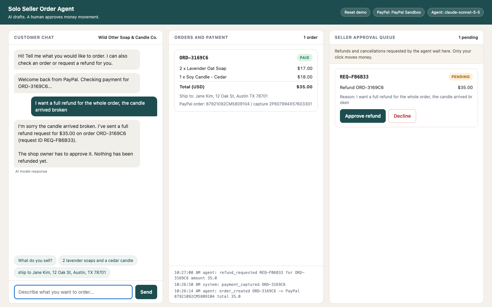
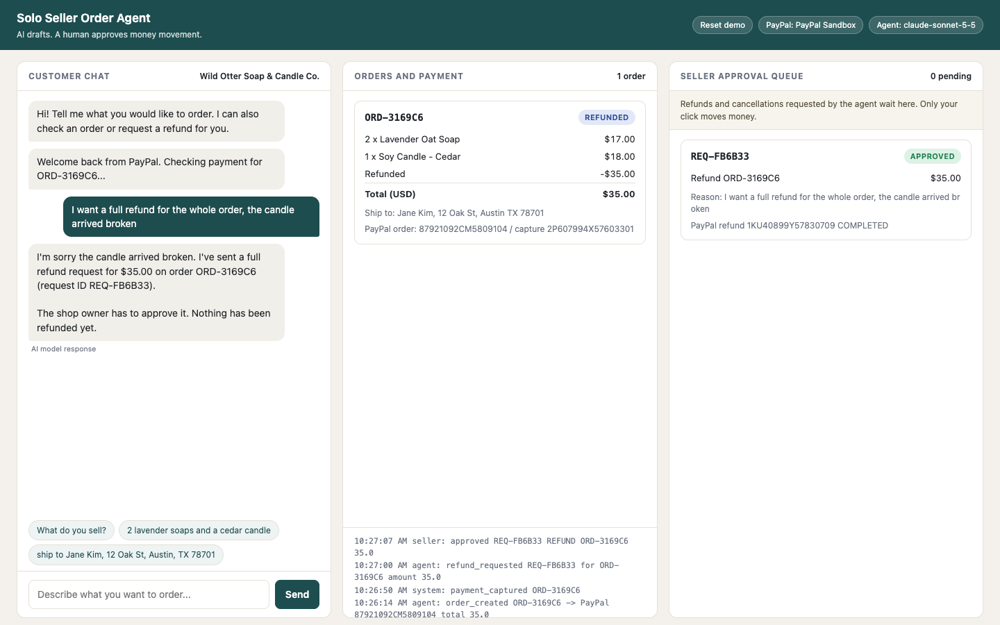
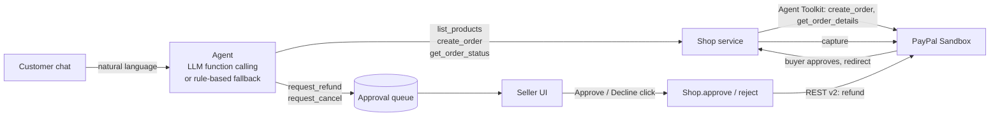

# Solo Seller Order Agent

> **AI drafts, human approves money movement.**
> A chat-to-checkout order agent for one-person shops, built on the PayPal Agent Toolkit and the PayPal Sandbox.



## Problem

A solo seller (soap maker, candle shop, print-on-demand artist) takes orders over DMs and email. Every order means re-typing items and prices, building a PayPal checkout by hand, checking whether it was paid, and handling refund requests at odd hours. Handing that to an AI agent is tempting, but nobody wants an LLM that can move money on its own.

## Solution

1. The customer chats in plain language ("2 lavender soaps and a cedar candle, ship to ...").
2. The agent turns it into a structured order draft. **Prices always come from the shop catalog**, never from the model or the customer.
3. The agent creates a **PayPal Order** in the sandbox and hands the customer a checkout link.
4. The agent checks payment status on request; paid orders are captured automatically after the buyer approves.
5. Refund and cancellation requests go to a **seller approval queue**. Nothing executes until the seller clicks Approve.

## Real sandbox run

Everything below ran against the real PayPal Sandbox (not mock mode) with a sandbox buyer account: chat order, PayPal Checkout approval, capture, refund request, seller approval, refund COMPLETED. The agent in this run was a real LLM (Claude `claude-sonnet-5-5` through function calling; every chat reply carries an "AI model response" tag in the UI). The demo video was re-recorded with the same setup.



The run is reproducible with `scripts/e2e_sandbox.py` (needs the app running and a sandbox buyer account in `.env`).

More screenshots: [order created](docs/e2e/1_order_created.png), [paid](docs/e2e/4_back_paid.png), [refund requested](docs/e2e/5_refund_requested.png). Demo video (under 3 minutes, real sandbox and real LLM, sandbox credentials covered): `docs/demo/solo_seller_order_agent_demo.mp4`, recorded by `scripts/record_demo.py`. Devpost text: [docs/devpost_submission.md](docs/devpost_submission.md).

## Architecture



The agent receives an `AgentTools` object that has **no** approve, refund-execution or gateway method. The refund call exists only behind `POST /api/approvals/{id}/approve`, a human-clicked endpoint. A test (`test_agent_has_no_money_moving_surface`) pins this. Customer text never sets a price: totals are computed from `app/catalog.json`.

## Where PayPal is used

| Step | PayPal piece |
|---|---|
| Create order + checkout link | Official **PayPal Agent Toolkit** (`paypal-agent-toolkit`), tool `create_order` (Orders v2, intent CAPTURE, `payment_source.paypal`) |
| Read order / payment status | Agent Toolkit tool `get_order_details` |
| Capture after buyer approval | Orders v2 `POST /v2/checkout/orders/{id}/capture`, sent through the toolkit's authenticated client |
| Refund (after seller approval) | Payments v2 `POST /v2/payments/captures/{id}/refund`, same client |

The Agent Toolkit has no refund or capture tool, so those two calls use REST v2 through the toolkit's own sandbox client (same auth, same base URL).

## Human-in-the-loop

- The agent can *request* a refund or cancellation (amount, reason, order) and tells the customer that a person must approve.
- The seller sees each request with reason and amount and clicks Approve or Decline.
- Guardrails in code: only paid orders can be refunded, amount is capped at the remaining captured amount, one open request per order, an approved request cannot run twice, and every action is written to an audit log shown in the UI.

## Public-demo hardening

Built so the app can be hosted for judges without one visitor affecting another or running up the LLM bill:

- **Per-visitor session isolation**: orders, approval requests, audit lines and chat history are scoped to a random browser session id. Another visitor cannot see, approve or reject your requests (404). **Reset demo** deletes only your own data.
- **Abuse limits** (`app/limits.py`, in memory, no extra dependency): messages are capped at 500 characters; each IP gets 30 messages per hour, after which replies switch to the rule-based path with a notice, and at twice that the chat is refused (429); a global cap of 500 LLM calls per UTC day, after which everyone gets rule-based answers; at most 10 orders per session. The first three limits are configurable in `.env` (see `.env.example`).
- **Path-prefix safe**: the UI and PayPal return redirects use relative URLs, so it also runs behind a reverse proxy at a sub-path (`uvicorn --root-path /demo`).

## Run it

Python 3.11+ (developed on 3.12).

```bash
uv venv --python 3.12 && source .venv/bin/activate
uv pip install -r requirements.txt
uv pip install --no-deps paypal-agent-toolkit   # its pinned crewai/langchain extras are not needed
cp .env.example .env                              # then fill in keys
./run.sh                                          # http://localhost:8000
```

(`pip` works the same way: `pip install -r requirements.txt && pip install --no-deps paypal-agent-toolkit`.)

### .env

```
PAYPAL_CLIENT_ID=...          # sandbox app, https://developer.paypal.com/dashboard/applications/sandbox
PAYPAL_CLIENT_SECRET=...
MOCK_PAYPAL=0
APP_BASE_URL=http://localhost:8000

LLM_BASE_URL=https://api.anthropic.com/v1/   # any OpenAI-compatible endpoint
LLM_API_KEY=...
LLM_MODEL=claude-sonnet-5-5
```

- **LLM**: Claude via Anthropic's OpenAI-compatible endpoint by default. For a local model (LM Studio): `LLM_BASE_URL=http://localhost:1234/v1`, `LLM_API_KEY=lm-studio`, `LLM_MODEL=<loaded model>`. With no `LLM_API_KEY`, a deterministic rule-based parser handles the same flow, and the UI badge says so. If the LLM call fails, the app falls back to the rules.
- **Mock mode**: with `MOCK_PAYPAL=1` (or no PayPal keys) the app uses a fake gateway with the same interface so the UI can be exercised offline. The header badge turns amber and reads "PayPal: MOCK". **Mock mode is for local development only; the submission demo and the judge instructions use the real PayPal Sandbox** (badge reads "PayPal: PayPal Sandbox").

## Testing as a judge (PayPal Sandbox)

1. Start the app with real sandbox keys (above). Open `http://localhost:8000`.
2. In the chat, send: `2 lavender soaps and a cedar candle`, then `ship to Jane Kim, 12 Oak St, Austin, TX 78701`.
3. Click **Pay with PayPal** and log in with a sandbox **personal (buyer)** account from https://developer.paypal.com/dashboard/accounts. Approve the payment; you return to the app and the order card turns PAID.
4. In the chat, send `I want a refund for ORD-XXXXXX, the candle arrived broken` (use your order id).
5. In the right column the request is PENDING and the order is still PAID. Click **Approve refund**; the card turns REFUNDED. Verify the refund in the sandbox business account's activity.

Tests (21, no network, mock gateway, LLM path stubbed): `pytest -q`.

## Project layout

```
app/main.py            FastAPI routes, buyer redirects, seller approval endpoints
app/agent.py           LLM tool loop + rule-based fallback
app/limits.py          per-IP and daily LLM abuse limits
app/shop.py            order logic, AgentTools (agent surface), approve/reject (human surface)
app/paypal_gateway.py  LiveGateway (Agent Toolkit + REST v2) and MockGateway
app/catalog.json       sample catalog (USD)
app/static/index.html  single-page UI
tests/                 pytest flow, isolation and limit tests
scripts/e2e_sandbox.py real-sandbox end-to-end run (saves docs/e2e/)
scripts/record_demo.py demo video recorder (narration via scripts/demo_tts.py)
scripts/screenshot.py  mock-mode UI screenshot helper
```

## License

MIT, see [LICENSE](LICENSE).
